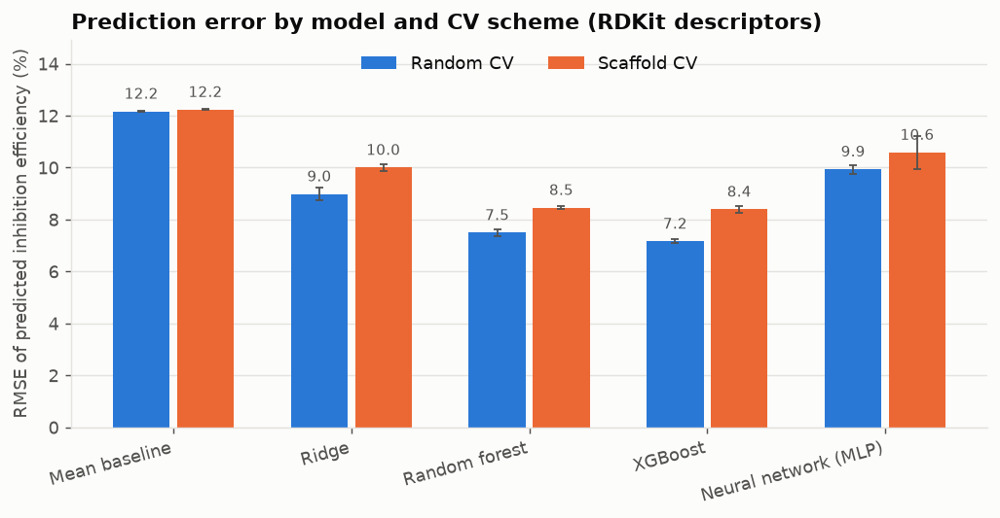
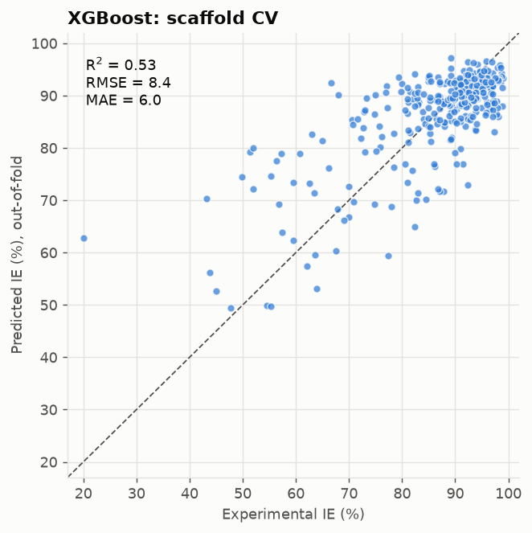
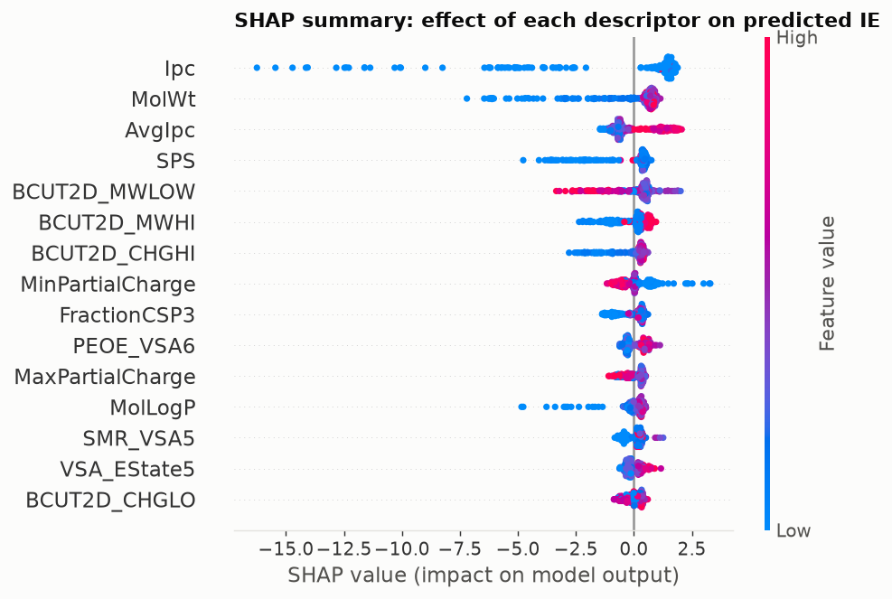
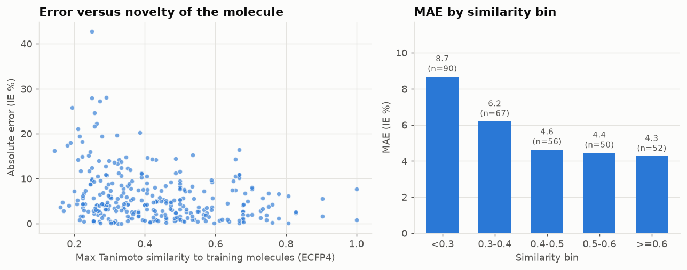

# Machine-learning prediction of corrosion inhibitor efficiency (QSPR)

Predicting the inhibition efficiency (IE, %) of organic corrosion inhibitors for carbon steel in 1 M HCl directly from molecular structure, with an emphasis on **honest evaluation**: leakage-free preprocessing, scaffold-based validation, and an applicability-domain analysis.

Related in topic to the author's undergraduate work on corrosion inhibition of mild steel in HCl, but this project is independent of the thesis data: it uses a public literature dataset.

## Key findings

| | Result |
|---|---|
| Best model | XGBoost on 2D RDKit descriptors |
| Scaffold CV (new chemical families) | R² = 0.52 ± 0.02, RMSE = 8.4 ± 0.1, MAE = 6.0 ± 0.1 |
| Random CV (same families allowed in train and test) | R² = 0.65 ± 0.02, RMSE = 7.2 ± 0.2, MAE = 5.0 ± 0.1 |
| Predict-the-mean baseline | R² ≈ 0, RMSE = 12.2 |

1. **Random splits overstate performance.** Moving from random to scaffold validation lowers R² from 0.65 to 0.52 for the best model. The scaffold figure is the realistic estimate for screening genuinely new compounds.
2. **Descriptors beat fingerprints on this small dataset.** With 315 molecules, ECFP4 bits alone give scaffold R² of at most 0.23, versus 0.52 for RDKit descriptors. Adding fingerprints to the descriptors did not help.
3. **Tree ensembles beat linear and neural models** (Ridge R² = 0.32, MLP R² = 0.24 under scaffold CV). The MLP is also the least stable across repeats.
4. **Errors increase for structurally dissimilar molecules.** The model achieves a mean absolute error of 8.68 percentage points for molecules with Tanimoto similarity below 0.3, compared with approximately 4.45 percentage points for molecules with similarity of 0.4 or greater, highlighting the importance of applicability-domain assessment.

## Figures

| Model comparison | Parity plot (scaffold CV) |
|---|---|
|  |  |

| SHAP summary | Applicability domain |
|---|---|
|  |  |

The parity plot shows the out-of-fold predictions from the first CV repeat, so its metrics differ slightly from the 3-repeat means above.

## What the model learned (SHAP)

Using SHAP values from an XGBoost model fitted on all data (full table: `results/shap_importance.csv`):

- **Larger, more complex molecules are predicted to be better inhibitors.** Molecular weight, Ipc, AvgIpc, BertzCT and SPS all push predictions up as they increase (Spearman correlation between descriptor value and SHAP value of +0.3 to +0.8). Several of these are strongly collinear (Ipc and molecular weight have a Spearman correlation of 0.97), so their relative ranking should not be over-interpreted.
- **More negative minimum partial charge raises predicted IE** (Spearman -0.86 with SHAP), consistent with electron-rich heteroatoms acting as adsorption sites on iron.
- **Higher lipophilicity (MolLogP) raises predicted IE** (Spearman +0.83).

These are statistical associations learned from literature data, not proven mechanisms.

## Method

1. **Data.** Fe-HCl-317 dataset (317 organic inhibitors, carbon steel, 1 M HCl, 25-30 °C, 1 mmol/L, EIS-measured IE) from Pham et al. 2024 (see References). Downloaded from the authors' repository by script; not redistributed here.
2. **Cleaning.** Structures are standardised to the largest fragment (41 of the 317 raw entries are salts or ionic liquids; counter-ions are discarded), invalid SMILES are dropped, and molecules that become identical are merged by averaging IE. This leaves 315 molecules and 161 Bemis-Murcko scaffolds.
3. **Features.** 217 RDKit 2D descriptors, 2048-bit ECFP4 fingerprints, and their concatenation.
4. **Leakage control.** Missing-value imputation, constant-feature removal and correlation filtering (|r| > 0.95) are fitted on the training fold only, inside each model's pipeline.
5. **Models.** Mean baseline, Ridge, random forest, XGBoost, and a scikit-learn MLP.
6. **Validation.** 10-fold CV repeated 3 times with different seeds, under two schemes: random, and scaffold-grouped (all molecules sharing a scaffold are in the same fold). Metrics are computed on pooled out-of-fold predictions; ± is the standard deviation across repeats.
7. **Interpretation.** SHAP (TreeExplainer) on XGBoost with named descriptors.
8. **Applicability domain.** Maximum Tanimoto similarity (ECFP4) of each held-out molecule to its training fold, against absolute error.

Full benchmark for every model, feature set and scheme: [`results/benchmark_table.md`](results/benchmark_table.md).

## Limitations

- **Small, heterogeneous dataset** (315 molecules from many papers, one concentration, one acid). Measurement noise between laboratories sets a floor on achievable error.
- **Skewed target.** 160 of 315 molecules have IE of 90% or higher and only 34 are below 70%. The model tends to over-predict poor inhibitors and compress the range (visible in the parity plot).
- **Counter-ions are discarded.** For the 40 ionic compounds remaining in the cleaned set only the largest fragment is modelled. One pair of ionic liquids sharing a cation but with different anions (IE 13.7 and 26.4) is merged to its mean for this reason.
- **Narrow validity.** Carbon steel, 1 M HCl, about 1 mmol/L inhibitor. Predictions outside these conditions are not supported. No quantum-chemical or adsorption-energy descriptors are used.
- **No external test set.** All numbers are cross-validated on one dataset. Hyperparameters were set once from reasonable defaults and not tuned extensively, and the best model was chosen on the same CV used for reporting, so scaffold-CV figures may be slightly optimistic.
- The original study used a different protocol (a pre-selected descriptor subset and its own CV setup), so its reported scores are not directly comparable to the ones here.

## Reproduce

```bash
git clone https://github.com/NickOmek/corrosion-inhibitor-qspr.git
cd corrosion-inhibitor-qspr
python -m venv .venv && source .venv/bin/activate   # Windows: .venv\Scripts\activate
pip install -r requirements.txt

python scripts/download_data.py      # fetch the dataset
python scripts/run_pipeline.py       # full study; runtime depends on hardware
python scripts/run_pipeline.py --quick   # fast smoke run, about 4 minutes
pytest -q                            # unit tests
```

For a guided, cell-by-cell version open `notebooks/01_walkthrough.ipynb`.

Predict new molecules (after running the pipeline once):

```python
from src.predict import predict_ie
predict_ie(["c1ccc2[nH]c(N)nc2c1", "CCCCCCCCCCCCCCCC[N+](C)(C)C.[Br-]"])
```

`max_similarity` in the output flags molecules far from the training data, where predictions are least reliable.

### Reproducibility Verification

The complete computational workflow was successfully executed in a dedicated Conda environment using Python 3.11.17 on Windows.

**Verification results:**

| Verification | Result |
|---|---|
| Automated unit tests | 8/8 passed |
| Best-performing model | XGBoost with RDKit descriptors |
| Scaffold cross-validation R² | 0.520 |
| Scaffold cross-validation RMSE | 8.39 percentage points |
| Full pipeline runtime | 2,128 seconds (35 minutes, 28 seconds) |

The reproduced performance metrics agree with the values reported in the benchmark summary at the stated precision.

These results confirm successful execution of the complete pipeline in the tested environment. They do not constitute independent external validation of the predictive model.

## Repository layout

```
├── src/
│   ├── config.py       # paths, seeds, constants
│   ├── data.py         # download, standardisation, de-duplication, scaffolds
│   ├── features.py     # RDKit descriptors, ECFP4, leakage-safe DescriptorFilter
│   ├── models.py       # model zoo (all pipelines)
│   ├── evaluate.py     # random and scaffold-grouped repeated CV
│   ├── interpret.py    # figures, SHAP, applicability domain
│   └── predict.py      # inference helper
├── scripts/            # download_data.py, run_pipeline.py, make_notebook.py
├── notebooks/          # 01_walkthrough.ipynb
├── tests/              # unit tests (splits, leakage, cleaning, metrics)
├── results/            # benchmark.csv, tables, figures, saved model
└── data/               # raw and processed data (downloaded, not committed)
```

## References

- Pham, T. H., Le, P. K., Son, D. N. A data-driven QSPR model for screening organic corrosion inhibitors for carbon steel using machine learning techniques. *RSC Advances* **2024**. Dataset: https://github.com/pth-lab/Fe-HCl-317-dataset
- Landrum, G. RDKit: open-source cheminformatics. https://www.rdkit.org
- Chen, T., Guestrin, C. XGBoost: a scalable tree boosting system. *KDD* 2016.
- Lundberg, S. M., Lee, S.-I. A unified approach to interpreting model predictions. *NeurIPS* 2017.

## License

Code: MIT (see `LICENSE`). The dataset belongs to its original authors; check their repository for terms of use.
